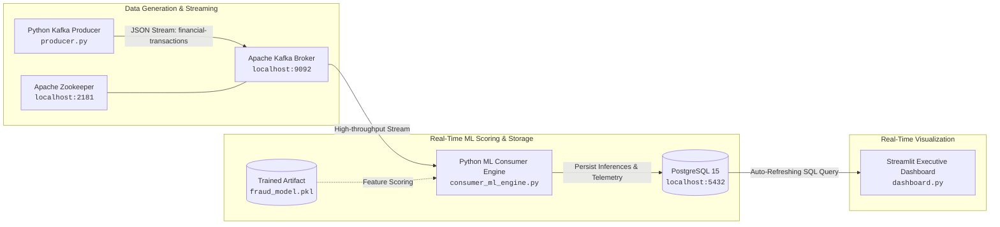

# 🛡️ Enterprise Real-Time Streaming Financial Fraud Detection Pipeline

A production-ready, fully containerized real-time streaming data pipeline and machine learning inference system for detecting financial credit card fraud at scale.

Built with **Apache Kafka**, **PostgreSQL**, **XGBoost / Scikit-Learn**, **Python**, and **Streamlit**.

---

## 🏛️ Architecture Overview



---

## 📁 Repository Structure

```
enterprise-streaming-fraud-pipeline/
├── docker-compose.yml          # Zookeeper, Kafka, and PostgreSQL cluster
├── requirements.txt            # Python dependencies (Kafka, ML, Streamlit, Plotly)
├── model_trainer.py            # Generates synthetic data, trains XGBoost, saves model
├── fraud_model.pkl             # Serialized ML model artifact bundle (generated)
├── producer.py                 # Real-time transaction generator & velocity attack simulator
├── consumer_ml_engine.py       # Kafka consumer, low-latency ML scoring, DB persistence
├── dashboard.py                # Executive dark-mode live analytical dashboard
└── README.md                   # Operational & architecture documentation
```

---

## ⚙️ Prerequisites

- **Docker & Docker Compose** installed and running.
- **Python 3.9+** (Tested on Python 3.9 - 3.12).
- `pip` or virtual environment manager (`venv` / `conda`).

---

## 🚀 Quickstart Guide

### 1. Clone & Navigate to Project

```bash
cd enterprise-streaming-fraud-pipeline
```

### 2. Start Infrastructure via Docker Compose

Spin up Apache Zookeeper, Apache Kafka, and PostgreSQL:

```bash
docker-compose up -d
```

Verify all containers are healthy:
```bash
docker-compose ps
```

*Port mappings on host:*
- **Kafka**: `127.0.0.1:9092`
- **PostgreSQL**: `127.0.0.1:5433` (`user: fraud_admin`, `password: fraud_password`, `db: fraud_detection`)
- **Zookeeper**: `localhost:2181`

---

### 3. Setup Python Virtual Environment & Install Dependencies

```bash
python3 -m venv venv
source venv/bin/activate    # On Windows: venv\Scripts\activate

pip install --upgrade pip
pip install -r requirements.txt
```

---

### 4. Train the ML Fraud Detection Model

Generate synthetic transaction data with realistic fraud distributions, train the cost-sensitive XGBoost classifier, evaluate metrics, and export `fraud_model.pkl`:

```bash
python model_trainer.py
```

*Expected Output:*
- Displays ROC-AUC (~0.98+), Precision, Recall, and Confusion Matrix.
- Creates `fraud_model.pkl` in the current directory.

---

### 5. Launch the ML Consumer & Inference Engine

In a new terminal window (with virtual environment activated):

```bash
python consumer_ml_engine.py
```

*What this does:*
- Connects to Kafka and PostgreSQL.
- Auto-creates the `transactions_log` table and indexes.
- Scores incoming transactions in real time (< 3ms latency) using `fraud_model.pkl`.
- Persists telemetry and prediction results into PostgreSQL.

---

### 6. Start the Kafka Transaction Producer

In a second terminal window (with virtual environment activated):

```bash
python producer.py
```

*What this does:*
- Streams synthetic transactions every 1 second into topic `financial-transactions`.
- Injects randomized burst **velocity attacks** and cross-border anomalies for live threat visualization.

---

### 7. Launch the Real-Time Executive Dashboard

In a third terminal window:

```bash
streamlit run dashboard.py
```

Open your browser at **`http://localhost:8501`**.

---

---

## 🇮🇳 Indian Financial Ecosystem Telemetry (`producer.py`)

The producer streams real-time financial transactions calibrated to the Indian financial ecosystem:
- **Authentic Indian Merchants & Platforms:** Zomato, Swiggy, Blinkit, Zepto, Amazon India, Flipkart, Myntra, JioMart, Apollo Pharmacy, BookMyShow, Croma, Reliance Digital, Tanishq Jewellers, Kalyan Jewellers, IOCL/HPCL Petrol Pumps, IRCTC Railways, IndiGo Airlines, CoinDCX, and UPI P2P transfers.
- **Indian Rupee (₹ / INR) Scales:** Realistic spend profiles ranging from ₹80 quick grocery orders to ₹2,50,000 high-value jewellery and electronics.
- **Regional Profiling & Geolocation State:** Cardholders anchored across Indian metropolitan corridors (Connaught Place New Delhi, South Mumbai, Indiranagar Bengaluru, T Nagar Chennai, Banjara Hills Hyderabad, Salt Lake Kolkata).
- **Contextual Indian Fraud Vectors:**
  1. *Impossible Indian Travel (Spatial Anomaly):* Rapid swipe in Madurai/Guwahati (1,500+ km away) within 15 minutes of baseline local activity.
  2. *Velocity Burst Attack:* 4–6 rapid successive swipes across major Indian aggregators (Flipkart, Croma, Tanishq).
  3. *3:30 AM Outlier Spike:* ₹98,000+ luxury jewellery or crypto swipe during late-night IST hours with elevated client device risk.

**CLI Controls:**
```bash
# Run baseline organic Indian traffic (~1.2% fraud)
python producer.py

# Launch continuous simulated fraud storm
python producer.py --storm

# Trigger specific fraud scenarios
python producer.py --scenario impossible_travel
python producer.py --scenario velocity_burst
python producer.py --scenario night_amount_outlier
```

---

## 🔬 Explainable AI (XAI) Threat Attribution Matrix

The dashboard computes on-the-fly **SHAP-style mathematical feature attributions** for flagged transactions:
- **Velocity Spike Score:** Percentage risk contribution from rapid successive requests.
- **Impossible Travel / Spatial Anomaly:** Geolocation displacement penalty.
- **INR Outlier Deviation:** Monetary deviation from cardholder spend history.
- **Late-Night IST Hours Risk:** 01:00 AM – 05:00 AM threat factor.
- **Merchant Category Exposure:** Base sector risk weightings (crypto, luxury goods, electronics).
- **Interactive Visuals:** Visual horizontal attribution breakdown charts alongside the **GenAI Threat Intelligence Investigator**.

---

## 📊 Dashboard Features

- **Stabilized Time-Weighted Rolling Window**: Computes sliding metrics over 60s windows alongside cumulative baselines to eliminate metric jitter.
- **Live KPI Summary**: Total Processed, Fraud Flagged, 60s Fraud Rate %, Processed Volume ($), and Prevented Loss ($).
- **Time-Series Scatter & Flow**: Visual stream showing normal vs flagged transactions over time.
- **High-Risk Merchant Category Breakdown**: Real-time distribution of incidents across crypto exchanges, luxury goods, electronics, airlines, etc.
- **Threat Vector Breakdown**: Donut chart segmenting velocity bursts, foreign transactions, high device risk, and night activity.
- **Live Tabular Feed & Alert Center**: Auto-refreshing table highlighting high-risk transactions with native interactive progress bars.

---

## 🛑 Teardown

To shut down running Python scripts, press `Ctrl+C` in each terminal.

To stop and remove Docker containers and volumes:

```bash
docker-compose down -v
```
